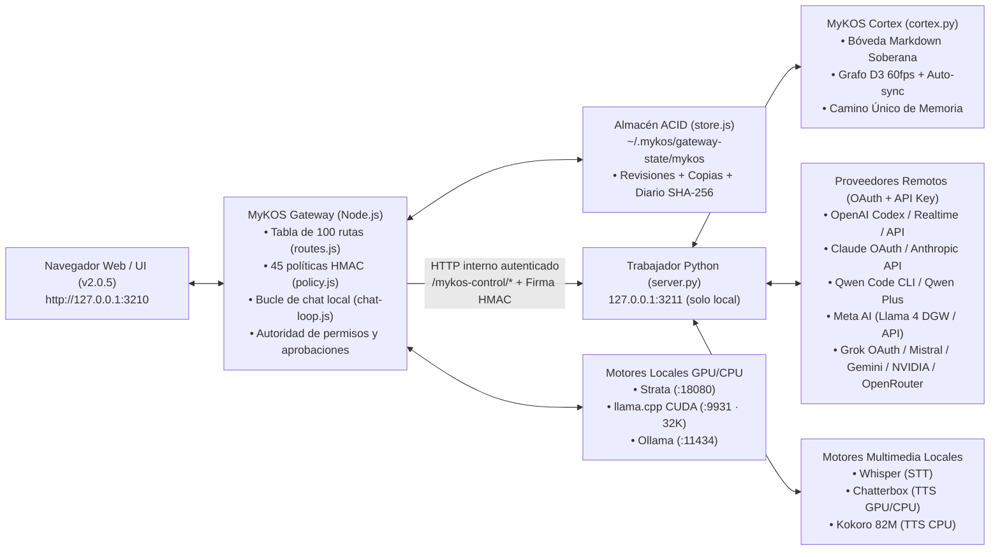

# MyKOS Ecosystem

> **MyKOS**: Plataforma personal de inteligencia artificial, pasarela multimodelo gobernada por políticas, motor de voz bidireccional y suite de aplicaciones para **Linux** y **Windows**.

---

## 🏛️ Estructura del Repositorio

```text
MyKOS/
├── bin/
│   ├── mykos                 # CLI unificado para Linux (run, start, stop, status, doctor, rea, store, realtime, test)
│   ├── mykos.ps1             # CLI unificado para Windows PowerShell
│   └── mykos.cmd             # Lanzador para Windows CMD
├── install.sh                # Instalador automático para Linux (venv, enlaces en ~/.local/bin, systemd)
├── install.ps1               # Instalador automático para Windows (venv, PATH de usuario, acceso directo)
├── CONTRIBUTING.md           # Guía oficial para colaboradores: cómo añadir herramientas y proveedores
├── tests/                    # Suite de auditoría de seguridad y pruebas unitarias de aislamiento
│
├── gateway/                  # MyKOS Gateway: Pasarela multimodelo, autoridad de permisos y Web UI
│   ├── runtime/              # Servidor HTTP y supervisor nativo en Node.js (mykos-gateway.mjs)
│   │   ├── antigravity-home/ # Perfil aislado de solo texto (deny total de herramientas) para agy
│   │   └── qwen-home/        # Perfil aislado de configuración para Qwen Code CLI
│   ├── app/                  # Trabajador Python y conectores de modelos/herramientas
│   │   ├── server.py         # Enrutador interno (/mykos-control/*) y orquestación del backend
│   │   ├── cortex.py         # Motor MyKOS Cortex: grafo de conocimiento y bóveda Markdown soberana (v2.0.5)
│   │   ├── core/             # Paquete modular de servicios del servidor backend (v2.0.5)
│   │   │   ├── activity.py   # Registro efímero de actividad y supervisión de servidores locales
│   │   │   ├── benchmark.py  # Suite de benchmarks y telemetría de rendimiento
│   │   │   ├── claude.py     # Integración con Claude CLI y suscripción OAuth
│   │   │   ├── integrity.py  # Guardia contra alucinaciones de acciones del asistente
│   │   │   ├── ollama_catalog.py # Integración con el catálogo público y descargas de modelos
│   │   │   ├── providers.py  # Gestión de catálogos y autenticación dual (OAuth + API Key) de proveedores
│   │   │   ├── runners.py    # Bucle universal de herramientas y runners de inferencia
│   │   │   └── uploads.py    # Gestión y purga de archivos temporales multipart
│   │   ├── tools/            # Paquete modular de herramientas del sistema (v2.0.5 · 12 submódulos)
│   │   │   ├── schemas.py    # Esquemas JSON formales de herramientas y lista de sensibles
│   │   │   ├── cortex_tools.py # Camino único de memoria en Cortex (search_cortex, read_cortex_note, save_cortex_note)
│   │   │   ├── filesystem.py # Operaciones en disco, búsquedas y fichas de investigación
│   │   │   ├── shell.py      # Subprocesos seguros y semáforo heurístico de riesgo
│   │   │   ├── git_tools.py  # Operaciones de control de versiones Git
│   │   │   ├── system.py     # Hardware, procesos y servicios systemd
│   │   │   ├── documents.py  # Lectura de PDF, Office e imágenes con OCR
│   │   │   ├── web.py        # Búsqueda DuckDuckGo y navegación web con anti-SSRF
│   │   │   └── ollama.py     # Gestión e introspección de modelos locales Ollama
│   │   ├── rea.py            # Motor integrado REA (Reverse Engineer Anything · 207 herramientas MCP)
│   │   ├── strata.py         # Conector para el motor local CUDA Strata (Qwen3.8 125B / Qwen3.6 35B)
│   │   ├── qwen_cli.py       # Conector para Qwen Code CLI / Suscripción Qwen Plus y enrutamiento local
│   │   ├── static/           # Interfaz web reactiva v2.0.5 (index.html, app.js, styles.css)
│   │   └── gateway-plugin/
│   │       ├── mykos-ui/     # Núcleo del Gateway (index.js, routes.js, policy.js, chat-loop.js, store.js)
│   │       ├── store-cli.mjs # Utilidad CLI de verificación, exportación y auditoría del almacén
│   │       └── tests/        # Batería de pruebas automatizadas de rutas, políticas, almacén, Cortex y voz
│   └── optional/
│       └── codex/            # Extensión opcional de cliente Codex
│
├── apps/                     # Suite de aplicaciones de escritorio nativas de MyKOS
│   ├── monitor/              # MyKOS Monitor (GTK4 + Cairo): telemetría en tiempo real de CPU, GPU, RAM, disco y red
│   └── analizador/           # Analizador MyKOS (PySide6): mapa visual de uso de disco y buscador de duplicados
│
└── docs/                     # Informes técnicos de arquitectura e ingeniería inversa (REA)
```

---

## ⚙️ Cómo Funciona la Arquitectura de MyKOS

MyKOS separa estrictamente **quién decide y guarda los datos** (el **Gateway en Node.js**) de **quién ejecuta las herramientas o habla con proveedores externos** (el **Trabajador en Python**):



1. **Frontera Única y Política Firmada:** El navegador solo se comunica con el Gateway (`127.0.0.1:3210`). Toda petición pasa primero por [`routes.js`](gateway/app/gateway-plugin/mykos-ui/routes.js) (100 rutas clasificadas por dominio y nivel de riesgo: `read`, `write`, `sensitive`) y por [`policy.js`](gateway/app/gateway-plugin/mykos-ui/policy.js) (45 políticas HMAC que validan esquemas JSON, aplican límites de concurrencia/ritmo por minuto y adjuntan la cabecera firmada `X-MyKOS-Gateway-Decision`).
2. **Bucle de Chat Propiedad del Gateway (`chat-loop.js`):** Para los modelos locales (Strata, llama.cpp y Ollama), el propio Gateway ejecuta el bucle de herramientas, inyecta la hora local de Madrid en el último turno del usuario (preservando la caché de prompt del sistema), verifica cada acción con la **Guardia de Integridad Anti-Alucinaciones** y calcula la telemetría universal (`tokens/s`, `TTFT`, tokens de entrada/salida y duración).
3. **MyKOS Cortex — Grafo de Conocimiento y Camino Único de Memoria (`cortex.py`):** Toda la memoria de largo plazo reside en tu bóveda Markdown soberana (`[[wikilinks]]`, `#etiquetas`, frontmatter YAML y carpetas). Cuenta con sincronización viva en segundo plano (`mtime`/`size`), visualización interactiva de grafo de fuerzas D3 a 60 fps en la pestaña **Cortex**, creación de notas desde la interfaz y un único camino de memoria gobernado (`search_cortex`, `read_cortex_note`, `save_cortex_note`).
4. **Tres Modos de Permiso en Tiempo Real:**
   - **Solo lectura (`solo_lectura`):** Bloquea cualquier herramienta sensible sin preguntar.
   - **Supervisado (`supervisado`, por defecto):** Las herramientas de lectura se ejecutan al instante y las sensibles generan una solicitud de aprobación en la interfaz (con opción a conceder permiso una vez, por sesión o permanente).
   - **Acceso total (`acceso_total`):** Concede y audita automáticamente permisos permanentes para herramientas elegibles; las acciones críticas de un solo uso (`once`) siguen requiriendo confirmación humana.
5. **Almacén Transaccional (`store.js`) y Actualizador Integrado:** Las conversaciones, configuraciones, permisos, aprobaciones, recordatorios, subagentes y nodos se guardan mediante escrituras atómicas con control de revisión y diario `journal.jsonl`. La cabecera incluye la píldora de versión **`v2.0.5`** con comprobación automática de nuevos commits/releases en GitHub y actualización en un clic.

---

## 🧠 Motores que Usa MyKOS y Para Qué Sirve Cada Uno

### 1. Motores de Inferencia Local (GPU CUDA / CPU)

| Motor | Modelos Destacados | Puerto / Interfaz | Para qué se usa en MyKOS |
| :--- | :--- | :--- | :--- |
| **Strata** ([`strata.py`](gateway/app/strata.py)) | `strata/qwen3.8-flash-next-iq2_xs-32k` (125B MoE), `strata/qwen3.6-35b-a3b` (Visión + MTP) | `http://127.0.0.1:18080` (`/v1/chat/completions`) | Motor local principal de alto rendimiento con CUDA. Antes de consultarlo, el Gateway descarga automáticamente los modelos de Ollama en VRAM (`unloadOllama()`) para evitar conflictos de memoria. Soporta herramientas nativas, razonamiento y benchmark. |
| **llama.cpp CUDA** ([`index.js`](gateway/app/gateway-plugin/mykos-ui/index.js)) | `mykos-cuda` (`GLM-4.7-Flash` / GGUF locales) | `http://127.0.0.1:9931` | Servidor `llama-server` gestionado bajo demanda con ventana de contexto de **32K tokens** por defecto. Antes de arrancar o inferir, descarga automáticamente Ollama de la VRAM (`unloadOllama()`) y se detiene al cambiar a otro motor para liberar la GPU. |
| **Ollama** | Cualquier modelo local instalado (`qwen3`, `llama3`, `gemma3`, etc.) | `http://127.0.0.1:11434` (`/api/chat`) | Gestión de modelos locales multiuso desde la vista **Modelos** (organizada en pestañas plegables `Ajuste`, `Rendimiento`, `Biblioteca` y `Ollama` con indicadores luminosos ON/OFF) y generación automática del **Diario de Sesión** (`diario-mykos.md`). |

### 2. Motores y Proveedores en la Nube / OAuth (Autenticación Dual OAuth + API Key)

| Proveedor | Módulo | Método de Autenticación | Para qué se usa en MyKOS |
| :--- | :--- | :--- | :--- |
| **Qwen Code CLI / Qwen Plus** | [`qwen_cli.py`](gateway/app/qwen_cli.py) | Suscripción OAuth de Qwen Code CLI, API Key DashScope o enrutamiento local Ollama | Modelos `qwen-cli/qwen3.8-max`, `qwen-cli/qwen3.8-flash` y `qwen-cli/qwen-plus` con soporte de herramientas autónomas, aislamiento de entorno sin fugas de secretos y enrutamiento directo a modelos locales de Ollama. |
| **Mistral AI / Vibe** | [`mistral.py`](gateway/app/mistral.py) | Enlace automático al keyring de Vibe (`ai.mistral.vibe`) o API Key cifrada | Chat y uso de herramientas con modelos Mistral (`mistral-medium`, `codestral`, etc.) reutilizando la sesión autenticada de Vibe en el sistema. |
| **Anthropic Direct API** | [`anthropic_api.py`](gateway/app/anthropic_api.py) | API Key (`sk-ant-...`) cifrada con `mykos-sealed-v1` | Acceso directo a `claude-3-7-sonnet`, `claude-3-5-sonnet` y `claude-3-5-haiku` con visión, razonamiento y herramientas sin depender del CLI. |
| **Claude Code OAuth** | [`server.py`](gateway/app/server.py) | Suscripción `claude.ai` vía CLI oficial | Uso de `claude-sonnet-oauth` con ventana de 131K tokens y protocolo JSON estructurado gobernado por MyKOS (con las herramientas nativas del CLI deshabilitadas). |
| **OpenAI (Codex OAuth + API Key)** | [`oauth.py`](gateway/app/oauth.py) | Doble método: Sesión OAuth aislada de MyKOS o API Key (`sk-...`) cifrada | Modelos `openai-codex-oauth/gpt-5.6-luna` (258K contexto), catálogo directo OpenAI API, delegación de razonamiento para llamadas de voz y soporte WebRTC Realtime. |
| **Google Gemini API** | [`gemini.py`](gateway/app/gemini.py) / [`gemini_live.py`](gateway/app/gemini_live.py) | API Key (`AIza...`) cifrada + Tokens efímeros de un solo uso | Modelos Gemini en chat multimodal y llamadas de voz **Gemini Live** por WebSocket bidireccional sin exponer jamás la API key al navegador. |
| **NVIDIA NIM / Kimi / OpenRouter** | [`nvidia.py`](gateway/app/nvidia.py), [`kimi.py`](gateway/app/kimi.py), [`oauth.py`](gateway/app/oauth.py) | API Key cifrada (`nvapi-...`, Kimi) y doble método OAuth PKCE + API Key en OpenRouter | Catálogo extendido de modelos remotos con el protocolo unificado de herramientas e integridad de MyKOS. |
| **Grok (xAI)** | [`grok.py`](gateway/app/grok.py) | OAuth 2.0 (RFC 8628 Device Flow) o API Key cifrada con `mykos-sealed-v1` | Modelos `grok/grok-4.7`, `grok/grok-4.6`, `grok/grok-4.5`, `grok/grok-4` y `grok/grok-3` con contexto de hasta 512K tokens y bucle de herramientas. |
| **Meta AI (`meta.ai` OAuth + API Key)** | [`meta_ai.py`](gateway/app/meta_ai.py), [`meta_ai_dgw.mjs`](gateway/app/meta_ai_dgw.mjs) | Doble método: Sesión OAuth (`ecto1` + OIDC) o API Key compatible con Llama API | Conexión directa por WebSocket DGW + Protobuf/WASM a `wss://gateway.meta.ai/ws` o vía API para usar `meta-ai/llama-4-fast`, `meta-ai/llama-4-reasoning` (Think Hard) y `meta-ai/meta-ai-assistant` con herramientas gobernadas por MyKOS. |
| **Antigravity CLI (`agy`)** | [`antigravity_cli.py`](gateway/app/antigravity_cli.py) | Sesión Google propia de `agy` en perfil aislado (`runtime/antigravity-home`) | Consultas de solo texto a modelos Gemini Argon / Claude Opus / GPT-OSS mediante `agy --mode plan --sandbox`, con bloqueo estricto (`deny`) de todas las herramientas del CLI. |

### 3. Motores de Voz, Audio, Imagen y Memoria Soberana (Cortex)

| Componente | Motor / Tecnología | Ubicación | Función |
| :--- | :--- | :--- | :--- |
| **MyKOS Cortex (Grafo y Memoria)** | **Indexador Markdown + Grafo D3 + Búsqueda Multicapa** | [`cortex.py`](gateway/app/cortex.py), [`cortex_tools.py`](gateway/app/tools/cortex_tools.py) | **Camino único de memoria** sobre tu bóveda Markdown estilo Obsidian. Indexa `[[wikilinks]]`, `#etiquetas` y metadatos YAML con auto-sincronización en tiempo real (`mtime`/`size`), grafo visual interactivo y herramientas unificadas (`search_cortex`, `read_cortex_note`, `save_cortex_note`). |
| **Generación de Imágenes** | **Motor de Difusión Flux / Pollinations** | [`media.py`](gateway/app/media.py), [`tools/`](gateway/app/tools/) | Herramienta gobernada `generate_image` para generar imágenes en alta definición con control de aspecto (1:1, 16:9, etc.), guardarlas en el almacén local `data/media` y renderizarlas interactivamente en la burbuja de chat. |
| **Transcripción de Voz (STT)** | **OpenAI Whisper** (`large-v3-turbo` con autodetección de caché local) | [`whisper_worker.py`](gateway/app/whisper_worker.py) | Proceso persistente en segundo plano que transcribe el micrófono en local sin enviar audio a servicios externos. |
| **Síntesis de Voz Natural (TTS GPU/CPU)** | **Chatterbox Multilingual** (voces `alvaro` y `elvira`) | [`chatterbox_worker.py`](gateway/app/chatterbox_worker.py) | Síntesis de voz en español de alta naturalidad sobre CUDA; si la VRAM está ocupada por un LLM grande, vacía caché y conmuta automáticamente a CPU. |
| **Síntesis de Voz Ligera (TTS CPU)** | **Kokoro 82M** + `espeak-ng` (voces `em_alex` y `ef_dora`) | [`kokoro_worker.py`](gateway/app/kokoro_worker.py) | Motor TTS ultrarrápido en CPU sin consumo de VRAM, ideal cuando la GPU está dedicada al 100 % a inferencia. |
| **Llamadas en Tiempo Real** | **Motor Local por Turnos** / **OpenAI WebRTC Realtime** / **Gemini Live** | [`voice-engine.js`](gateway/app/gateway-plugin/mykos-ui/voice-engine.js), [`realtime.js`](gateway/app/gateway-plugin/mykos-ui/realtime.js) | Streaming frase a frase (NDJSON) en modo local, o conexión bidireccional de baja latencia con soporte de interrupción y herramientas supervisadas. |
| **Ingeniería Inversa (REA)** | **REA (`rea-agents` MCP · 207 herramientas)** | [`rea.py`](gateway/app/rea.py), [`tools/`](gateway/app/tools/) | Sesión persistente MCP JSON-RPC con las 207 herramientas de **Reverse Engineer Anything** (`rea_status`, `rea_list_tools`, `rea_inspect_binary`, `rea_analyze_javascript`, `rea_call_tool`) para decompilación nativa/gestionada, análisis de ELF/PE/Mach-O/APK/WASM/Firmware y bundles JS/Electron. |

---

## 🛠️ Instalación Rápida (Linux y Windows)

### En Linux:
Clona el repositorio e inicia el asistente de instalación (o descarga el paquete `.deb` oficial desde Releases):

```bash
git clone https://github.com/eskib0/MyKOS.git ~/MyKOS
cd ~/MyKOS
./install.sh
```

¿Qué hace `./install.sh`?
1. Verifica que tengas **Node.js (>= 20)** y **Python 3 (>= 3.10)**.
2. Crea el entorno virtual en `~/.mykos/venv` e instala las dependencias de [`gateway/app/requirements.txt`](gateway/app/requirements.txt) (usa `./install.sh --no-venv` si prefieres no tocar el entorno virtual).
3. Enlaza en `~/.local/bin/` el comando maestro **`mykos`** y asegura que `~/.local/bin` tenga prioridad en tu `PATH` por encima de `/usr/bin`.
4. Sincroniza automáticamente `~/.mykos/gateway-state/mykos-gateway.json` hacia el directorio actual del repositorio y reinicia el Gateway si estaba en ejecución para aplicar siempre la última versión.
5. *(Opcional)* Con `./install.sh --systemd`, crea y habilita el servicio de usuario `mykos-gateway.service` para que arranque automáticamente con tu sesión.

### En Windows (Instalador `.exe` o PowerShell):
Puedes instalar MyKOS con el instalador gráfico **`MyKOS-Setup-2.0.5.exe`** disponible en GitHub Releases (incluye Node.js 20 y Python 3.12 portables sin requerir permisos de administrador), o desde PowerShell clonando el repositorio:

```powershell
git clone https://github.com/eskib0/MyKOS.git "$HOME\MyKOS"
cd "$HOME\MyKOS"
powershell -ExecutionPolicy Bypass -File .\install.ps1
```

¿Qué hace `install.ps1`?
1. Verifica **Node.js (>= 20)** y **Python 3 (>= 3.10)** (si no están instalados, descarga automáticamente los runtimes portables en `runtime\`).
2. Crea el entorno virtual en `$HOME\.mykos\venv` e instala las dependencias de [`gateway/app/requirements.txt`](gateway/app/requirements.txt).
3. Añade la carpeta `bin` (`mykos.cmd` / `mykos.ps1`) al `PATH` de tu usuario de Windows.
4. Sincroniza la configuración viva `mykos-gateway.json` hacia el directorio instalado y reinicia el Gateway si estaba en marcha.
5. Crea el acceso directo **MyKOS Live Run** en tu Escritorio.

---

## 💻 Guía de Comandos `mykos`

Una vez ejecutado `./install.sh`, puedes controlar todo el ecosistema con el comando `mykos`:

### Gestión del Servidor y Diagnóstico (`doctor`)
```bash
mykos run                   # Arranca MyKOS con el logo y logs en vivo; al cerrar esa terminal se detiene todo
mykos start                 # Arranca MyKOS Gateway en segundo plano (http://127.0.0.1:3210)
mykos start --fg            # Arranca en primer plano con el banner de MyKOS y logs en vivo
mykos start --port 19001    # Arranca en un puerto específico
mykos status                # Muestra el estado del Gateway, Backend Python, Almacén, Políticas y Voz
mykos doctor                # Diagnóstico integral: entorno, rutas de config, permisos 0600/0700, almacén ACID y procesos
mykos doctor --fix          # Repara automáticamente permisos, rutas desactualizadas, temporales corruptos y procesos huérfanos
mykos doctor --deep         # Ejecuta el diagnóstico completo más las 6 baterías de pruebas de seguridad
mykos open                  # Abre la interfaz web de MyKOS en el navegador
mykos logs                  # Muestra el logo de MyKOS y las últimas líneas del log del Gateway y Backend
mykos logs -f               # Muestra el logo de MyKOS y sigue los logs en tiempo real
mykos restart               # Reinicia limpiamente MyKOS Gateway y su backend
mykos stop                  # Detiene MyKOS Gateway y todos los subprocesos supervisados
mykos test                  # Ejecuta toda la batería de tests (rutas, políticas, almacén, voz y seguridad)
```

### Gestión del Almacén de Datos y Voz en la Nube
```bash
mykos store status          # Muestra revisiones, recuentos, copias e instantáneas del almacén ACID
mykos store verify          # Verifica la integridad de todos los documentos del almacén
mykos store repair          # Limpia temporales y restaura automáticamente documentos dañados desde backups
mykos store export --to ./backup  # Exporta conversaciones, memoria y permisos a ficheros JSON estándar
mykos realtime status       # Comprueba si hay credencial configurada para OpenAI Realtime
mykos realtime set-key      # Guarda de forma segura (0600) la API key para llamadas Realtime
mykos realtime on           # Activa el modo de voz en la nube (OpenAI WebRTC)
mykos realtime off          # Vuelve al modo de voz 100 % local (Whisper + Chatterbox/Kokoro)
```

### Ingeniería Inversa y Auditoría de Binarios con REA
Puedes usar REA directamente desde el **Chat Web de MyKOS** diciendo:
> *"MyKOS, usa REA y revisa `<nombre_del_programa_o_ruta>`"*

O desde la terminal con el subcomando `mykos rea`:
```bash
mykos rea status                  # Verifica el motor REA (rea-agents) y sus 207 herramientas MCP
mykos rea tools [filtro]          # Lista o busca entre las 207 herramientas de ingeniería inversa
mykos rea inspect <programa|ruta> # Analiza un binario o programa por nombre (ej: ls, ollama) o ruta
mykos rea call <tool> '<json>'    # Invoca cualquier herramienta MCP de REA directamente
```

### Lanzamiento de Aplicaciones de Escritorio
```bash
mykos monitor               # Abre MyKOS Monitor (dashboard del sistema en tiempo real)
mykos analizador            # Abre Analizador MyKOS (mapa de disco y limpieza de duplicados)
```

---

## 🔒 Privacidad y Seguridad

- **Cero secretos en el repositorio:** Todas las credenciales se cifran localmente con `mykos-sealed-v1` (stream cipher HMAC-SHA256 en modo CTR + Encrypt-then-MAC con clave maestra local con permisos `0600`) en `~/.mykos/gateway-state/mykos/credentials/`.
- **Aislamiento de red:** El Gateway y el trabajador Python escuchan exclusivamente en `127.0.0.1` y verifican `Host`, `Origin` y tokens internos en tiempo constante (`timingSafeEqual` / `hmac.compare_digest`).
- **Terminal web desactivada por defecto:** El endpoint `/terminal` permanece bloqueado salvo que se habilite explícitamente con `MYKOS_ENABLE_WEB_TERMINAL=1`.
- **Raíces autorizadas acotadas:** Las herramientas de ficheros solo pueden operar dentro de las carpetas declaradas en [`gateway/app/config/allowed_roots.json`](gateway/app/config/allowed_roots.json), bloqueando por código cualquier intento de registrar `/` como raíz.

---

## 🗺️ Roadmap de Seguridad y Deuda Técnica

Puntos identificados durante las auditorías de endurecimiento para futuras iteraciones:
1. **Evolución del sellado de credenciales:** Actualmente se utiliza el esquema `mykos-sealed-v1` (stream cipher HMAC-SHA256 en modo CTR + autenticación Encrypt-then-MAC con nonce aleatorio de 128 bits y clave maestra local `0600`). Se contempla como evolución opcional estandarizar hacia un primitivo AEAD (`AES-256-GCM` o `ChaCha20-Poly1305`) e integración con el keyring del sistema operativo.
2. **Endurecimiento frente a condiciones de carrera (TOCTOU):**
   - **Symlink TOCTOU:** Uso de `openat2(RESOLVE_NO_SYMLINKS)` / `dir_fd` con `O_NOFOLLOW` en Linux para evitar manipulación concurrente de enlaces simbólicos durante la escritura de archivos.
   - **DNS TOCTOU:** Fijación de la IP resuelta (*IP pinning*) en `web_fetch` y `browser.py` para eliminar la ventana de DNS rebinding entre la validación y la conexión HTTP.
