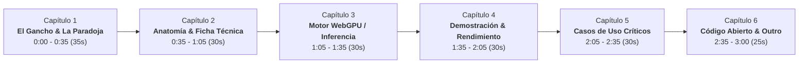
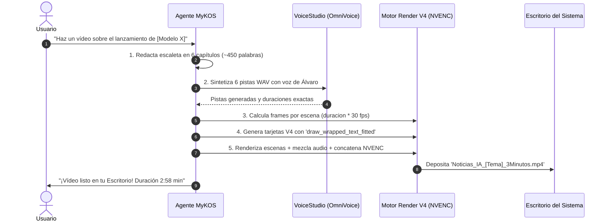

# 🎬 HOJA DE RUTA & MANUAL MAESTRO DE PRODUCCIÓN
## Skill MyKOS: Generador Autónomo de Vídeos de Noticias de IA para YouTube

> **Filosofía del Canal:** «Tu máquina, tus reglas.»  
> **Formato Estándar:** Mini-documental cinematográfico de 3 minutos (180 segundos), Full HD 1080p a 30 FPS, con locución nativa en español, mezcla acústica de estudio, estética HUD técnico/cyberpunk y cero dependencia de servidores o APIs de pago en la nube.

---

## 1. 🛡️ Las Tres Reglas de Oro Anti-Errores (Lecciones Críticas)

Para garantizar la máxima calidad y evitar regresiones en cualquier vídeo producido por MyKOS o por agentes, es de obligado cumplimiento respetar estas tres reglas:

```
┌─────────────────────────────────────────────────────────────────────────────┐
│ 1. CERO TEMBLORES (ANTI-JITTER)                                             │
│    • NUNCA aplicar zoom/pan (Ken Burns) recortando y reescalando texto      │
│      ya rasterizado fotograma a fotograma. Discretizar enteros causa jitter.│
│    • SIEMPRE renderizar en 1080p nativo sólido con transiciones             │
│      matemáticas continuas (Cosine Cross-Dissolve, Smoothstep Slide).       │
├─────────────────────────────────────────────────────────────────────────────┤
│ 2. CERO DESBORDAMIENTO (BOUND SAFETY)                                       │
│    • NUNCA fijar tamaños de letra estáticos sin verificar el alto y ancho.  │
│    • SIEMPRE usar 'draw_wrapped_text_fitted' con auto-escalado dinámico      │
│      y un margen de seguridad de 30-40 px respecto al borde de cada tarjeta.│
├─────────────────────────────────────────────────────────────────────────────┤
│ 3. FIDELIDAD EDITORIAL ABSOLUTA (100% NOTICIA)                              │
│    • NUNCA colar promociones invasivas o alucinar datos autorreferenciales. │
│    • SIEMPRE ceñirse a los datos comprobables: autor, modelo, tamaño,       │
│      pesos, arquitectura, benchmarks de latencia, demo real y repositorio.  │
└─────────────────────────────────────────────────────────────────────────────┘
```

---

## 2. ⏱️ Escaleta Estándar de 3 Minutos (Estructura en 6 Capítulos)

El vídeo se divide en **6 capítulos calibrados** de forma que el ritmo visual y narrativo mantenga la retención máxima en YouTube:



### Detalle de Contenido por Capítulo:

| Capítulo | Tiempo Aprox. | Duración | Palabras | Objetivo Narrativo y Visual |
| :--- | :---: | :---: | :---: | :--- |
| **1. El Gancho & La Paradoja** | `0:00 - 0:35` | ~35s | 75-85 | **Gancho inicial impactante**. Confrontar la narrativa tradicional de la nube (macroservidores, costes, latencia) con la irrupción del modelo local. Ficha inicial del lanzamiento. |
| **2. Anatomía Técnica** | `0:35 - 1:05` | ~30s | 65-75 | **Ficha de ingeniería**. Número exacto de parámetros, peso del archivo en MB/GB, cuantización (FP8/FP16), consumo de VRAM y compatibilidad de hardware. |
| **3. El Motor Tecnológico** | `1:05 - 1:35` | ~30s | 65-75 | **Cómo funciona por dentro**. WebGPU, shaders WGSL, acceso directo al silicio de la GPU sin necesidad de entornos Python ni CUDA pesados. Código fuente de ejemplo. |
| **4. Demostración en Tiempo Real** | `1:35 - 2:05` | ~30s | 70-80 | **Prueba empírica**. Demostración de latencia cero (habla mientras escribes), oscilograma acústico en tiempo real y la prueba del *Modo Avión* (cero telemetría externa). |
| **5. Casos de Uso Críticos** | `2:05 - 2:35` | ~30s | 70-80 | **Por qué importa al espectador**. Aplicaciones médicas (secreto profesional), banca, industria y talleres sin internet, domótica e IoT sin suscripción. |
| **6. Veredicto & Cierre YouTube** | `2:35 - 3:00` | ~25s | 60-70 | **Conclusión soberana y llamada a la acción**. Repositorio GitHub y enlaces en la descripción, pregunta abierta a comentarios, botón de suscripción y lema final: *«Tu máquina, tus reglas»*. |

---

## 3. 🎙️ Identidad Sonora y Especificaciones de Audio

Para que todos los vídeos del canal posean la misma identidad sonora inconfundible (estilo documental tecnológico):

### 3.1. Locutor Oficial (OmniVoice GPU)
- **Voz de referencia:** Álvaro (español de España, tono documental, cercano, riguroso y enérgico).
- **Entorno de ejecución:** `/home/ruben/.config/VoiceStudio/runtime/project/.venv/bin/python`.
- **Motor:** `MyKOSVoiceStudio` con modelo OmniVoice sobre GPU local (`cuda:0`, RTX 5060).
- **Parámetros acústicos fijados:**
  - `seed`: `42` (consistencia tímbrica entre escenas).
  - `speed`: `1.05` (ritmo dinámico de YouTube sin perder articulación).
  - `guidance_scale`: `2.2`.
- **Normalización de la locución:** Pico máster fijado en `0.85` (unos -1.4 dBFS).

### 3.2. Pistas de Acompañamiento y Efectos
1. **Chime de Cabecera (Spielberg Chime):**
   - Archivo: `intro_digital_chime.wav`
   - Posición: Inicia en `t = 0.0s` hasta `t = 2.0s`.
   - Ganancia: Pico escalado a `0.35`.
2. **Lecho Ambiental (Ambient Pad):**
   - Archivo: `ambient_pad.wav`
   - Volumen de mezcla: Calibrado a `-27 dB` (factor de amplitud `0.045`).
   - Comportamiento: Reproducción en bucle continuo durante los 180 segundos con fundido inicial (fade-in 1.5s) y fundido final (fade-out 2.0s).
3. **Sincronización Labial/Visual (Lead-In):**
   - Capítulo 1: Margen previo de **2.0 segundos** (para que suene el chime y aparezca la cabecera antes de que empiece a hablar el locutor).
   - Capítulos 2 a 6: Margen previo de **0.33 segundos (10 frames a 30 fps)** para que el ojo del espectador asimile la nueva tarjeta gráfica antes de la locución.
4. **Formato Máster:** 48.000 Hz, estéreo, codificado en AAC a 320 kbps (o 288 kbps regulado).

---

## 4. 🎨 Identidad Visual y Motor Gráfico V4

La imagen debe respirar la identidad estética del canal: una consola de comando y HUD técnico de alta tecnología.

### 4.1. Paleta Cromática Oficial
```python
BG_DARK       = (9, 13, 22)      # Fondo espacial profundo
BG_CARD       = (15, 21, 34)     # Tarjeta principal oscura
BG_CARD_LIGHT = (22, 30, 48)     # Tarjeta secundaria / resaltada
BORDER_DARK   = (36, 48, 72)     # Borde técnico sutil
CYAN          = (0, 240, 255)    # Acento primario tecnológico
EMERALD       = (52, 211, 153)   # Datos positivos / rendimiento local
AMBER         = (245, 158, 11)   # Advertencias / métricas de advertencia
PURPLE        = (168, 85, 247)   # Destacados de arquitectura / hardware
RED_ALERT     = (239, 68, 68)    # La nube / cuotas / problemas tradicionales
TEXT_WHITE    = (248, 250, 252)  # Texto titular
TEXT_MUTED    = (148, 163, 184)  # Texto secundario / leyendas
```

### 4.2. Fuentes Tipográficas del Sistema
- **Titulares Impactantes:** `Inter-Black.ttf` (tamaños 36 a 68 px).
- **Subtítulos y Cabeceras de Tarjeta:** `Inter-Bold.ttf` (tamaños 20 a 28 px).
- **Cuerpo de Texto Explicativo:** `DejaVuSans-Bold.ttf` (tamaños 16 a 18 px).
- **Consola, Código y Métricas:** `RobotoMono-Regular.ttf` (tamaños 16 a 24 px).

### 4.3. Algoritmo Obligatorio de Auto-Ajuste de Texto
```python
def draw_wrapped_text_fitted(draw, pos, text, font_path, initial_size, fill, max_width, max_height, line_spacing=6):
    """Garantiza que ningún texto desborde su tarjeta reduciendo dinámicamente el tamaño de letra."""
    cur_size = initial_size
    while cur_size >= 11:
        font = get_font(font_path, cur_size)
        bbox = font.getbbox("AyÁg")
        line_h = (bbox[3] - bbox[1]) + line_spacing
        
        paragraphs = text.split("\n")
        all_lines = []
        for p in paragraphs:
            words = p.split(" ")
            curr_line = []
            for word in words:
                if not word: continue
                test_line = " ".join(curr_line + [word])
                w = draw.textlength(test_line, font=font)
                if w <= max_width:
                    curr_line.append(word)
                else:
                    if curr_line:
                        all_lines.append(" ".join(curr_line))
                        curr_line = [word]
                    else:
                        all_lines.append(word)
                        curr_line = []
            if curr_line:
                all_lines.append(" ".join(curr_line))
        
        total_h = len(all_lines) * line_h
        if total_h <= max_height or cur_size <= 11:
            x, y = pos
            for i, line in enumerate(all_lines):
                draw.text((x, y + i * line_h), line, fill=fill, font=font)
            return total_h, cur_size
        cur_size -= 1
```

### 4.4. Transiciones Cinematográficas Matemáticas
En lugar de cortes bruscos o saltos por zoom:
1. **Cosine Cross-Dissolve:** `alpha = (1.0 - math.cos(math.pi * (idx + 0.5) / total_len)) / 2.0` (duración: 18 frames / 0.6s).
2. **Smoothstep Lateral Slide:** `p = (idx + 1) / total_len; p = p * p * (3 - 2 * p)` (desplazamiento horizontal progresivo).
3. **Dip to Dark Glow:** Fundido a negro profundo con curva exponencial `1.3` para separar bloques temáticos de alto contraste.

---

## 5. 🤖 Integración de Medios Generados con ComfyUI (Wan 2.1 & Flux)

Cuando la noticia se preste a clips cinematográficos animados (como planos de chips microscópicos, redes neuronales pulsantes o servidores holográficos):

1. **Servidor ComfyUI:**
   - URL: `http://127.0.0.1:8188`
   - Parámetros: `--lowvram --disable-auto-launch --offline` sobre la RTX 5060 de 8 GB.
2. **Modelo de Vídeo:**
   - Modelo: `wan2.1_t2v_1.3B_bf16.safetensors`
   - Clip Text: `umt5_xxl_fp8_e4m3fn_scaled.safetensors`
   - Resolución: 832×480 a 16 fps, reescalado con interpolación Lanczos e integrado dentro de una ventana con marco HUD.
3. **Regla de Integración:**
   - Los vídeos o imágenes generadas se insertan **dentro de ventanas o tarjetas con borde y sombras**, NUNCA como fondo ruidoso debajo de párrafos de texto pequeños.

---

## 6. 🚀 Pipeline de Producción Automatizado de la Skill de MyKOS

Para que MyKOS pueda producir un nuevo vídeo de noticias a partir de un enlace o un texto, ejecutará las siguientes 5 etapas:



---

## 7. 📋 Metadatos y Paquete de Publicación para YouTube

Junto a cada vídeo `.mp4`, la skill generará automáticamente un archivo `.txt` con los metadatos optimizados para YouTube:

1. **Título sugerido (2 opciones):**
   - Opción Directa/Técnica: `[Nombre del Modelo]: La IA de voz de [X] MB que corre en el navegador sin internet`
   - Opción Curiosidad/Gancho: `¿El fin de las APIs en la nube? Esta IA cabe en un USB y no necesita internet`
2. **Descripción optimizada con Marcas de Tiempo (Timestamps):**
   ```text
   Analizamos en detalle el lanzamiento de [Modelo X], el nuevo modelo que desafía a la nube...

   ⏱️ MARCAS DE TIEMPO:
   0:00 - La Paradoja de la Nube vs Local
   0:35 - Especificaciones y Anatomía Técnica
   1:05 - Cómo funciona WebGPU y el silicio local
   1:35 - Demostración en tiempo real (Latencia Cero)
   2:05 - Casos de uso: Medicina, Banca y Privacidad
   2:35 - Código abierto, enlaces y veredicto final

   🔗 ENLACES DEL VÍDEO:
   • Repositorio en GitHub: [URL]
   • Demostración interactiva: [URL]

   «Tu máquina, tus reglas.»
   ```
3. **Etiquetas (Tags):** `IA local, WebGPU, síntesis de voz, inteligencia artificial 2026, código abierto, privacidad, hardware local, noticias IA`.

---

## 8. 📂 Ubicación de Recursos Oficiales

| Recurso | Ruta en el Sistema |
| :--- | :--- |
| **Directorio de Producción:** | `/home/ruben/MyKOS/promo_v2/documentary_woof_3min/` |
| **Script Maestro V4 de Referencia:** | `/home/ruben/MyKOS/promo_v2/documentary_woof_3min/render_woof_v4.py` |
| **Generador de Audio Oficial:** | `/home/ruben/MyKOS/promo_v2/documentary_woof_3min/generate_audio_woof.py` |
| **Librería VoiceStudio:** | `/home/ruben/MyKOS/promo_v2/template_studio/voice_generator.py` |
| **Entorno Python Multimedia:** | `/home/ruben/.config/VoiceStudio/runtime/project/.venv/bin/python` |
| **Lecho Sonoro Pad:** | `/home/ruben/MyKOS/promo_v2/documentary_woof_3min/ambient_pad.wav` |
| **Chime Inicial:** | `/home/ruben/MyKOS/promo_v2/documentary_woof_3min/intro_digital_chime.wav` |
| **Carpeta de Entrega al Usuario:** | `/home/ruben/Escritorio/` |
