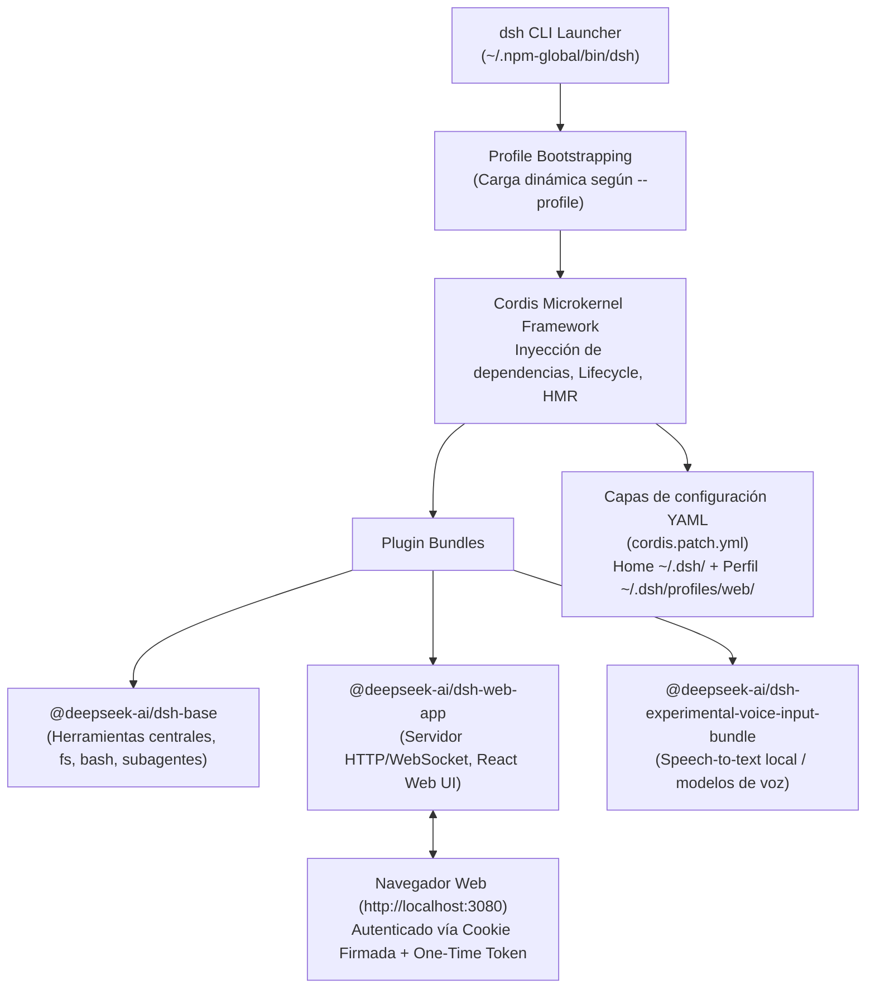

# Informe de Ingeniería Inversa con REA: DeepSeek Harness (`dsh web`)

Análisis estructural, de ingeniería inversa estática y de ejecución realizado mediante **REA** (*Reverse Engineer Anything*) sobre la instalación y el entorno activo de **DeepSeek Harness** (`dsh`) y su perfil Web (`dsh-web-app`).

---

## 1. Resumen Ejecutivo y Ledger de Evidencias

| Dimensión | Detalle observado / inferido | Evidencia REA |
| :--- | :--- | :--- |
| **Paquete y Versión** | `@deepseek-ai/dsh` v0.2.1-rc.2 (instalación global npm) | `capture_process_scenario` (`ev_a93428477fbdb6165f5afa97fc9ec5363c3033bb325ca9a632ee3a94f79dce5c`) |
| **Repositorio Oficial** | `git+https://github.com/deepseek-ai/deepseek-harness.git` | `analyze_javascript_application` (`ev_83c456f17f7088979a7f2f4b90fc13a0b9efbcbbf57365a24b24c649fedd07dd`) |
| **Licencia** | **MIT License** (Open Source permisiva oficial) | `package.json` / `LICENSE` de `@deepseek-ai/dsh` |
| **Punto de Entrada CLI** | `~/.npm-global/bin/dsh -> ../lib/node_modules/@deepseek-ai/dsh/lib/bin.js` | SHA-256: `80112efe368efb1a39720c7ada0af00442e5131fb2744edaaff8a3e8bb499e6f` |
| **Root Artifact Digest** | `c1c80178f878a7315df4fdfbadfa5b1fa111f7155e2686dc7112adec39ae9ec8` | REA JS Graph (`ev_aa7a849058554fea2cccbb486c33043c5704662cf1fdfea6e0b114692267b785`) |
| **Subcomando Web** | `dsh --profile web` / `dsh web` (`@deepseek-ai/dsh-web-app`) | `capture_process_scenario` (`ev_b43c691bd25df64235d43b87f5ede1cef0c21607bc8df0c901f223d6cc94c6ac`) |
| **Proceso Activo** | PID `63621` ejecutando `node ~/.npm-global/bin/dsh web` en el puerto `3080` | Sockets de red activos TCP `localhost:3080` (LISTEN / ESTABLISHED) |

---

## 2. Topología y Arquitectura del Sistema

A diferencia de clientes tradicionales monolíticos, DeepSeek Harness utiliza una arquitectura de **microkernel extensible basado en Cordis** (`@deepseek-ai/cordis` v4):

### 2.1. El Sistema de Perfiles (`Profiles`)
El CLI de `dsh` no ejecuta una única aplicación fija, sino perfiles modulares que declaran sus propios bundles y plugins:
- **`web`**: La interfaz gráfica de navegador (`dsh web` o `dsh --profile web`).
- **`headless`**: Modo de ejecución batch para scripts o CI/CD (`dsh headless "tarea"`).
- **`acp`**: Servidor en modo ACP (*Agent Communication Protocol*) para comunicarse con clientes y editores externos sobre stdio.
- **`sdk` / `sdk-minimal`**: API JSON-RPC sobre stdio para integración directa con bibliotecas cliente.

### 2.2. Modelo de Configuración y Parches (`cordis.patch.yml`)
- Las configuraciones se organizan en arrays de parches dirigidos por ID (`id-targeted patch entries`).
- **Soporte HMR (*Hot Module Replacement*)**: Con `@deepseek-ai/dsh-hmr`, los cambios en `cordis.patch.yml` se detectan y recomponen en caliente en tiempo de ejecución sin requerir reinicio del daemon.

---

## 3. La Superficie Web (`dsh web` / `dsh-web-app`)

### 3.1. Características y Capacidades
- **Interfaz Interactiva**: Chat reactivo con streaming de tokens, visualización de árboles de herramientas y subagentes, inspector de estado y configuración de modelos.
- **Seguridad en Red y Reverse-Proxy**:
  - Enlace estricto a loopback (`127.0.0.1` o `::1`) por defecto; rechaza direcciones comodín (`0.0.0.0`).
  - Barrera de confianza para Host/Origin (`--trusted-host`) para prevenir ataques de DNS rebinding y CSRF.
  - Generación de token único en el arranque; el navegador intercambia el token por una cookie de sesión firmada `Secure`.
  - Soporte TLS nativo (`--tls-cert` y `--tls-key`) y adaptación a ingress/reverse proxies con `--public-url`.

### 3.2. Configuración Local del Usuario (`~/.dsh/profiles/web/cordis.patch.yml`)
En tu entorno se observan configurados los siguientes proveedores y modelos:
1. **OpenRouter**: Conectado mediante `OPENROUTER_API_KEY`.
   - Modelo por defecto: `qwen/qwen3.6-plus`.
2. **Ollama Local** (`http://127.0.0.1:11434/v1`):
   - Modelos declarados: `qwen3.6:35b`, `nemotron-3.5-bolt:latest`, `lfm2.5:24b`, `qwen2.5:7b`, entre otros.
3. **Preset Agéntico Activo**: `standard` (con soporte para ejecución de shell persistente, subagentes, recordatorios y gestión de tareas).

---

## 4. Herramientas y Capacidades Integradas en DSH

DeepSeek Harness incluye una suite completa de plugins de herramientas:
- **Terminal y Shell**:
  - `tool-bash` y `tool-bash-persistent`: Ejecución de comandos en shell interactiva con sesión persistente.
  - `tool-pwsh` / `tool-pwsh-persistent`: Soporte de PowerShell.
- **Sistema de Ficheros**:
  - `tool-fs`: Lectura/escritura atómica de archivos.
  - `tool-fs-search`: Búsqueda indexada en el workspace.
  - `tool-str-replace-editor`: Editor de código por reemplazo de cadenas sin sobreescrituras descontroladas.
- **Orquestación y Subagentes**:
  - `tool-subagent` y `tool-subagent-control`: Despliegue de agentes hijos y equipos de agentes (`agent-team-profile`).
  - `tool-goal` y `dsh-goal-round-driver`: Modos de persecución autónoma de metas.
  - `tool-schedule`: Planificación de tareas temporizadas y cron.
- **Integración con Estándares**:
  - `mcp-client`: Soporte nativo para servidores Model Context Protocol (MCP).
  - `tool-web`: Búsqueda y extracción web.

---

## 5. Licencia y Estado Open Source

- **Licencia**: **MIT** (Totalmente permisiva, código abierto bajo términos aprobados por la OSI).
- **Código Fuente**: Disponible abiertamente en el monorepo oficial de DeepSeek:
  👉 [github.com/deepseek-ai/deepseek-harness](https://github.com/deepseek-ai/deepseek-harness) (paquete en `apps/cli` y `packages/`).
