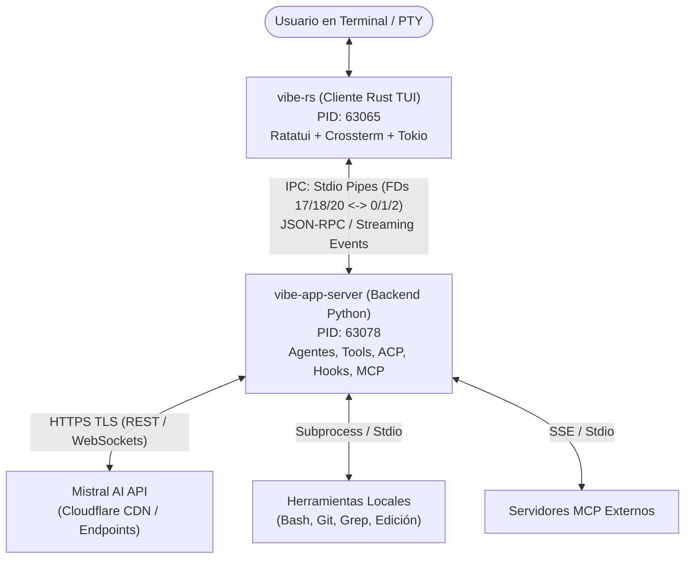

# Informe de Ingeniería Inversa con REA: Mistral Vibe (v3.0.3)

Este documento recoge el análisis estructural, de ingeniería inversa estática y de ejecución realizado mediante **REA** (*Reverse Engineer Anything*) sobre la instalación activa de **Mistral Vibe**.

---

## 1. Resumen Ejecutivo y Ledger de Evidencias

| Dimensión | Detalle observado / inferido | Evidencia REA |
| :--- | :--- | :--- |
| **Paquete y Versión** | `mistral-vibe v3.0.3` instalado vía `uv tool` en Python 3.14 | `capture_process_scenario` (`ev_f6d3b88c5c36dc17bfad4bfd4ba88b8d035399bff4eb9984d72280376bd67bb8`) |
| **Binario Nativo TUI** | `~/.local/share/uv/tools/mistral-vibe/lib/python3.14/site-packages/vibe/_bin/vibe-rs` | `inspect_rust_binary` (`ev_a4da598d6ce052e8310ea5f44b860a5e37d9f280ee3b66ca8cfce804d51f3eb8`) |
| **SHA-256 (vibe-rs)** | `d6818cd648406d117921b93c888a89e39a6e35d2ab6b80c2b8d9a53b96182394` (165,303,688 bytes) | `inspect_with_objdump` (`ev_f0cf5f8cff499bd6743edc0acb26ca8cc53bf456faa15f9febe9af4479c5bb18`) |
| **Formato y Arquitectura** | ELF 64-bit x86-64, LSB pie executable, dinámico, con símbolos DWARF intactos | `inspect_with_objdump` (`ev_0fefc91590ad6423ac1d5f328d6e5c6807a40dccbbd570a93b853d2363f8e586`) |
| **Compilador Rust** | `rustc` commit `58cf8f9c35b355199727627d07ae34a4e2846d67` | `inspect_rust_binary` |
| **Configuración Activa** | CLI schema y opciones verificadas en PTY REA | `capture_process_scenario` (`ev_5afcaf7799c4b0eabd1027783a1d3af25420bd8613861f8dabb0153eaa3c5983`) |

---

## 2. Topología y Arquitectura del Sistema

Mistral Vibe implementa una arquitectura híbrida desacoplada en dos procesos principales coordinados mediante pipes anónimos (IPC standard I/O):

### 2.1. El Frontend Nativo (`vibe-rs`)
- **Framework de Interfaz**: Construido sobre `ratatui` y `crossterm`, optimizado para terminales modernos con soporte TrueColor y manipulación de layouts (`vibe_rs::ui::composer_layout`).
- **Seguridad y Credenciales**: Utiliza `keyring_core`, `secret_service` y `zbus_secret_service_keyring_store` para almacenamiento seguro de tokens y claves en el keyring del sistema Linux.
- **Observabilidad y Telemetría**: Integra cliente nativo de Sentry (`sentry_tracing`, `sentry_contexts`) para rastreo y reporte de fallos.
- **Audio y Voz**: Incluye módulos dedicados `vibe_rs::voice`, `voice_app`, `tts` y `audio_player` para interacción por voz.
- **Aislamiento de Trabajo**: Implementa `worktree_gate`, soporte nativo de git worktrees y control de carpetas de confianza (`trust_folders`).

### 2.2. El Backend (`vibe-app-server`)
- **Ciclo de Ejecución**: Ejecuta el bucle agéntico principal, gestión de contexto (`compaction`), histórico y transcripciones.
- **Protocolo ACP**: Incorpora un puente `vibe-acp` (*Agent Communication Protocol*) en `~/.local/bin/vibe-acp` para interoperabilidad con clientes externos y editores.
- **Políticas de Ejecución de Shell**: Contiene analizadores de AST (`_shell_command_policy.py` y `_shell_permission_analysis.py`) para clasificar de manera determinista los comandos ejecutados en `bash` antes de presentarlos al usuario o auto-aprobarlos.

---

## 3. Catálogo de Agentes y Herramientas

### 3.1. Perfiles de Agente Incorporados (`BUILTIN_AGENTS`)
1. **`ask`** (Default neutral): Solicita confirmación explícita al usuario para cada acción de herramienta que pueda modificar el sistema.
2. **`accept-edits`**: Auto-aprueba automáticamente las ediciones de ficheros (`edit`, `write_file`), pero requiere confirmación para ejecución de comandos shell o acciones destructivas.
3. **`smart-approve`**: Utiliza un clasificador de modelo que analiza el riesgo del comando o herramienta en tiempo de ejecución: auto-ejecuta acciones inocuas y pide confirmación solo ante operaciones riesgosas.
4. **`auto-approve`** (Modo `--yolo`): `bypass_tool_permissions = True`. Ejecuta todas las herramientas sin solicitar confirmación.
5. **`explore`**: Subagente especializado de sólo lectura. Tiene habilitadas únicamente las herramientas `grep`, `read_file` y `skill`.
6. **`lean`**: Perfil especializado en Lean 4 para asistencia en demostraciones formales y verificación matemática, empleando el modelo `leanstral` (`labs-leanstral-1-5`).

### 3.2. Herramientas Nativas (`vibe/core/tools/builtins`)
- **Manipulación de ficheros**: `read_file`, `write_file`, `edit`.
- **Inspección de código**: `grep`.
- **Ejecución en terminal**: `bash`, `experimental_bash`, `git_bash`, `managed_shell`, `windows_shell`.
- **Navegación e Internet**: `web_search`, `web_fetch`.
- **Orquestación y Subagentes**: `task` (lanzamiento de subagentes), `skill` (ejecución de habilidades), `todo` (seguimiento de tareas), `ask_user_question` (interacción directa).

---

## 4. Estado Local y Configuración en el Sistema

- **Ruta de configuración**: `~/.vibe/config.toml`
  - `theme`: `"atom-one-light"`
  - `voice_mode_enabled`: `true`
  - Modelo configurado: `mistral-medium-3.5` con razonamiento (`thinking = "high"`).
- **Procesos en Ejecución Detectados**:
  - `vibe-rs` (PID `63065` en `pts/2`)
  - `vibe-app-server` (PID `63078` en `pts/2`)
  - Ambos en el directorio personal del usuario (`~/`).

---

## 5. Límites y Unknowns del Análisis REA

> [!NOTE] Límites de la evidencia
> - El binario `vibe-rs` fue examinado mediante `inspect_rust_binary` y `inspect_with_objdump` (headers y secciones). El análisis estático profundo mediante descompilador Ghidra/Kuna no estuvo activo debido a la ausencia de un ejecutable de Java/Ghidra configurado en el entorno local.
> - La comunicación de red HTTPS se verificó a nivel de sockets activos hacia endpoints de Mistral AI protegidos por Cloudflare; no se interceptó tráfico TLS activo (no MITM).
